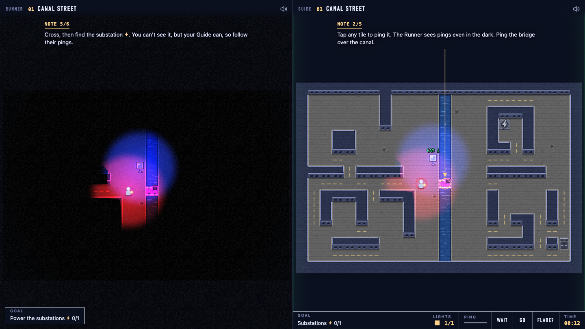
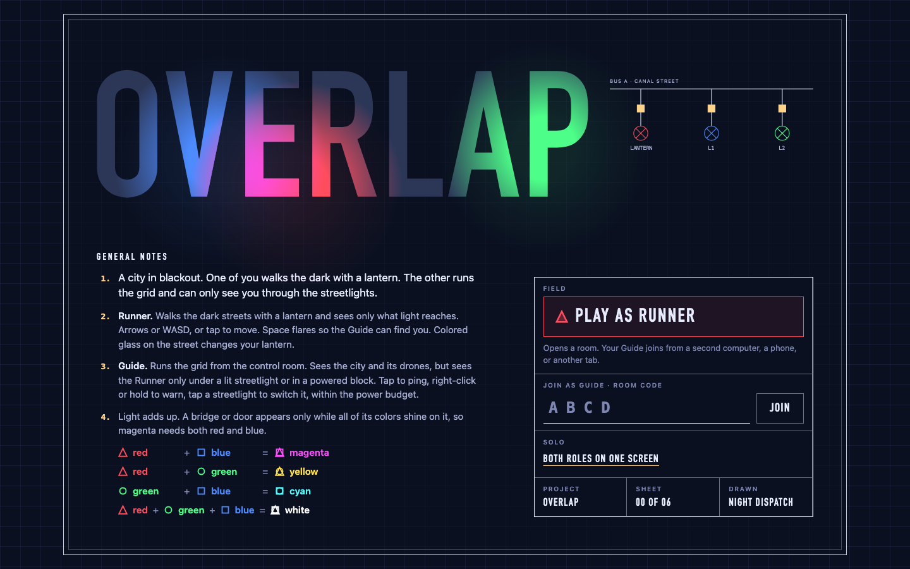

# Overlap

A two-player co-op puzzle game about a city in blackout, made for WolfJam 2026 (theme: **Visibility**).

**Play:** https://overlap.richardsun.workers.dev
**One screen, both roles:** https://overlap.richardsun.workers.dev/?local=1
**Source:** https://github.com/RichardJSun/overlap



## The idea

One player is the **Runner**, a field tech walking pitch-black streets with a lantern. They see only what light reaches, and outside the light there is nothing at all. The other player is the **Guide**, the night dispatcher in the utility's control room. The Guide sees the city map and its security drones, but the streetlights are the control room's only cameras, so the Guide sees the Runner only under a lit streetlight or inside a block that is back on the grid. The Guide drops pings, sends danger warnings, and switches colored streetlights on and off within a power budget. The Runner can **flare** their lantern to show the Guide where they are.

Light colors add. A colored bridge or door exists only while all of its colors shine on it, so a magenta bridge needs red and blue on the same tile (extra colors don't hurt). A drone shows up only under its own color. Colored glass **filters** on the street change the lantern's color, and in every district the Runner's glass brings colors that no streetlight has, so neither player can make the right mix alone.

| Mix | Makes | Where it matters |
|---|---|---|
| red lantern + blue streetlight | magenta | the canal bridge in district 1, locked doors |
| red lantern + green streetlight | yellow | locked doors, and a yellow drone that only shows where both lights overlap |
| green + blue | cyan | bridges, from glass or from two streetlights |
| red + green + blue | white | the last door in the city |

Every color also has a shape, so the game is playable without telling colors apart. Red is a triangle, green a circle, blue a square, and mixes overlay their shapes.

Each substation the Runner reaches powers its block for good, moves the checkpoint, gives the Guide more power, and lets the lantern reach one tile farther. The lantern starts every district at 3 tiles.

## The story

The game opens in the field tech's dark bedroom with the phone ringing on the nightstand. Answer it, and dispatch apologises for the hour while the skyline in the window turns from white to red, green, and blue and goes out. After that, the story comes only from in-world records. Each district opens on a call from a resident who has noticed something strange, and closes on a line in the utility's log. After the last district, the main breaker won't stay closed. When the two players fix its rule, the separated colors slide together into white across the city.

| District | The trick |
|---|---|
| 1 · Canal Street | the tutorial; red lantern + blue streetlight raise a magenta bridge |
| 2 · Market Street | the city has only blue light; the Runner's red and green glass bring the rest |
| 3 · Old Locks | only green streetlights, a long cyan bridge that needs two of them, and two glass colors to juggle |
| 4 · Signal Yard | a red drone that no streetlight can show, so the Guide can only warn |
| 5 · Grid Central | a yellow drone that only exists where the Runner's red meets a green streetlight, and a white door |
| 6 · Main Breaker | the Guide rewrites the breaker's safety rule in CEL against three tests; only the Runner can read the gauges and turn the override key |

## How to play

1. On one computer, open the game and press **Play as Runner**. A 4-letter room code appears.
2. On a second computer, open the link (there's a **Copy link** button), or type the code under **Join as Guide**. Two computers play best. A phone works too: scan the QR code. So does a second browser tab.
3. Talk to each other. That's the game.

No second device? Open [`?local=1`](https://overlap.richardsun.workers.dev/?local=1) to get both roles side by side in one window.

| | Runner | Guide |
|---|---|---|
| Move | arrows / WASD, or tap a tile | |
| Flare | Space, or tap yourself (4 s cooldown) | |
| Ping | | tap any tile (2 s cooldown) |
| Streetlight | | tap a streetlight to switch it (power budget shown as bars) |
| Danger ping | | right-click a tile, or hold on a phone |
| Signal | | Wait, Go and Flare? on the console, shown over the Runner's head |
| Main Breaker | K turns the override key, Space pulls the lever | type the rule, then Install |

District 1 is a tutorial. Each screen walks its player through their half of the game with numbered steps and a pointer over the tile to look at.

A drone touching the Runner sends them back to the last substation. If the Guide switches off the light holding up the bridge the Runner is standing on, the bridge vanishes, and so does the Runner. There are no lives and no game over.

## Theme

"Visibility" is the mechanic itself, in both directions. The Runner sees only what light reaches. The Guide sees the city but sees the Runner only through light too, because every streetlight is a camera. Switching a streetlight on both reveals the street to the Runner and reveals the Runner to the Guide. What one player can see, the other can't, and progress needs both views combined. The closest prior art we know is *Hue* (2016), where objects vanish when they match the background color. In Overlap, two players each control one light color and mix them to reveal the level.

## The look

Every screen is drawn as a sheet of the city's wiring drawing. Tutorial steps are numbered notes with a leader line to the tile they mean, the goal and the Guide's console sit in title-block cells, the power budget is a row of breaker symbols, and the breaker room is a one-line diagram. The lit OVERLAP wordmark on the title is a sign that only shows where the two streetlights and your lantern fall.



## How it's built

```mermaid
flowchart LR
  subgraph Laptop["Runner (computer)"]
    R[Runner scene<br/>authoritative: position, drones,<br/>substations, district]
  end
  subgraph Phone["Guide (second computer or phone)"]
    G[Guide scene<br/>authoritative: streetlights, pings]
  end
  subgraph CF["Cloudflare Worker"]
    W[fetch handler] --> DO[(Room Durable Object<br/>relay + last snapshot)]
  end
  R <-- WebSocket /room/CODE --> DO
  G <-- WebSocket /room/CODE --> DO
  R -. same pure lighting.ts .- G
```

- **Client:** TypeScript, Phaser 4, Vite. Every texture and every sound is generated in code. There are no image or audio files.
- **Server:** one Cloudflare Worker that serves the built client and routes `/room/CODE` to a SQLite-backed Durable Object per room. The Room does no game logic. It forwards messages to the other player and keeps the last snapshot, so a Guide who joins late (or reconnects) catches up.
- **Two kinds of seeing, one function.** The gate logic, the solver, the Runner's view, and the Guide's cameras (`onCamera` in [`src/shared/level.ts`](src/shared/level.ts)) all read the same pure light field.
- **Lighting is never sent over the wire.** Both clients compute the light field from shared state with the same pure function in [`src/shared/lighting.ts`](src/shared/lighting.ts). Messages go out only on change (a new tile, a toggled lamp, drones at most 5 times a second), which keeps a session well inside the Workers free plan.
- **The Main Breaker runs on CEL.** The Guide's rule is a [CEL](https://cel.dev) expression evaluated by `@marcbachmann/cel-js` over four readings. It only returns true or false. The Runner's client runs the three safety tests again before the breaker closes, and [`tests/breaker.test.ts`](tests/breaker.test.ts) checks that the obvious fixes fail for the right reasons.
- **Every district is proven solvable.** [`src/shared/level.ts`](src/shared/level.ts) has a breadth-first solver over (Runner tile, lights on, substations powered, lantern color) within the power budget. The tests check that each district can be solved, that it can't be solved without the Guide's lights, and that walling up any gate makes it unsolvable. The same solver drives a headless autoplayer ([`scripts/autoplay.mjs`](scripts/autoplay.mjs)) that plays the whole game in a real browser and waits out drones.

```
src/shared/   protocol, color masks, light field, level format + solver
src/scenes/   Runner, Guide, Intro (cold open), Breaker, Ending
src/render/   procedural textures, visibility polygons, lightmap, post effects
src/net/      Transport interface, WebSocket and in-memory (?local=1) transports
src/audio/    procedural WebAudio
src/levels/   district JSON
worker/       Worker + Room Durable Object
```

## Run it locally

Needs Node.js 22.18+ and Bun (for installs).

```bash
bun install
bun run dev          # cf dev: client + Worker + Durable Object on http://localhost:5173
bun run test         # Vitest: color, lighting, levels and solver, audio
bun run e2e          # Playwright: two-tab room test through cf dev
node scripts/autoplay.mjs   # headless full playthrough of ?local=1 (needs a dev server)
node scripts/net-check.mjs  # two browsers play one room through the deployed Worker
node scripts/record-demo.mjs http://localhost:5173 docs/demo.mp4   # demo video with the game's own sound
bun run deploy       # cf deploy
```

## Made with AI

Overlap was built in one day by AI coding agents (Claude Code), directed by Richard Sun. A main session owned the shared contracts and integration. Parallel agents built the network relay, the audio, the districts, the art, and the UI design, each in its own git worktree. The build log is in [docs/DEVLOG.md](docs/DEVLOG.md), and the key prompts are in [docs/PROMPTS.md](docs/PROMPTS.md). The original plan is [HANDOFF.md](HANDOFF.md).

Made at WolfJam 2026 by Richard Sun.
