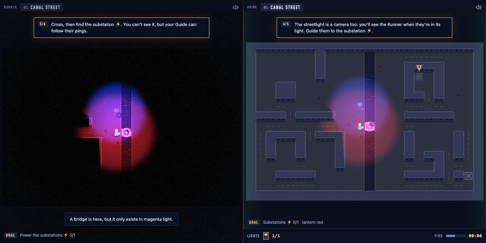
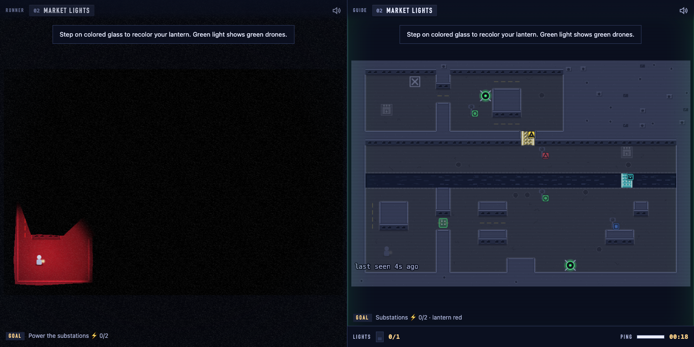
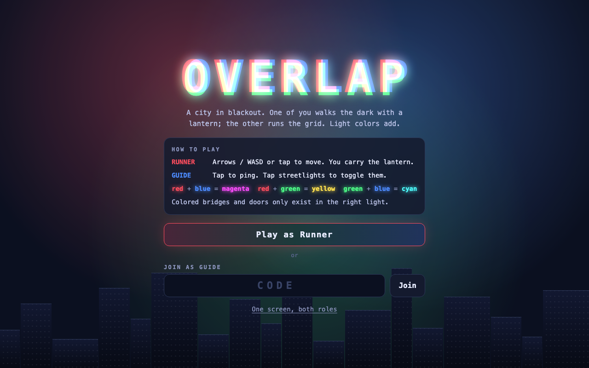
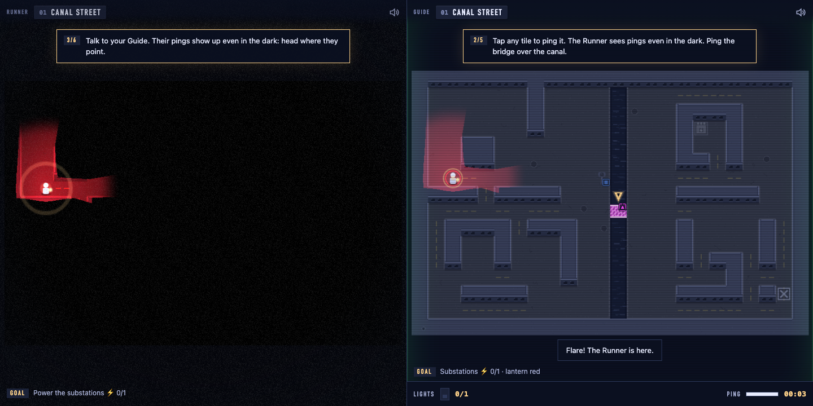
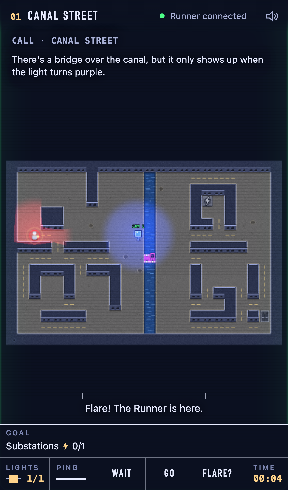

# Overlap devlog

Timestamped notes from the WolfJam 2026 build (theme: Visibility). Times are EST, Sat Nov 7, 2026.

## 12:27 Start
Empty repo. Plan and rules live in [HANDOFF.md](../HANDOFF.md).

## 12:35 M0 scaffold
- Vite 8 + Phaser 4.2 client (the handoff said Phaser 3; we took the current major), TypeScript 7.
- `cf init .` added the Cloudflare Vite plugin. `cloudflare.config.ts` declares the `Room` Durable Object (SQLite) and routes only `/room/*` to the Worker; every other path is the Vite build. `enable_ctx_exports` is the default at our compatibility date, so the flag is gone.
- `worker/index.ts` is a pure relay: one socket per role, forwards messages to the other role, stores the latest `snapshot` and replays it to a late-joining Guide.
- Pure shared logic: `color.ts` (3-bit RGB masks), `lighting.ts` (tile light field with line of sight), `level.ts` (level format, validator, BFS solver over runner tile x lights on x substations).
- District 1 "Canal Street" is solvable, and the solver proves it can't be solved with zero streetlights, so the Guide is required.
- Verified in the browser against `cf dev`: two sockets in room TEST, ping forwarded, snapshot replayed to a reconnecting Guide.
- Vitest gets its own config so logic tests don't boot the Workers runtime.

## 12:50 M1 + M2: Runner, Guide, local co-op
- `?local=1` runs two Phaser games side by side, wired by an in-memory `LocalTransport`.
- Runner: tile movement (arrows/WASD, tap-to-move with BFS), a red lantern, raycast visibility polygons, and a lightmap. The lightmap is a render texture filled near-black; each light's polygon is added in its color, then the texture is multiplied over the scene. Overlaps mix for free: red lantern + blue streetlight = magenta.
- Guide: the whole map dimmed, the lit field as an additive overlay, gates and lamps with colorblind glyphs, a power budget, and pings with a 2s cooldown. Drones the Runner can't currently see get an "unseen" tag.
- Gates use the same pure `lighting.ts` field as the solver, so what the solver proves is what the game enforces. A bridge that loses its light while the Runner stands on it drops them back to the checkpoint.
- `scripts/playthrough.mjs` drives headless Chromium through district 1: it checks the bridge is hidden, pings it, switches the blue light on, crosses, powers the substation, and exits. No console errors.
- Pitfall: the in-app browser pane pauses `requestAnimationFrame` while hidden, which looked like "keys don't work". Headless Playwright is the reliable check.

## 13:00 First deploy, M3 network
- `cf deploy` worked on the first try: https://overlap.richardsun.workers.dev. The production Room relays pings, and the headless district 1 playthrough passes against production.
- Merged the audio track: every sound is synthesized (no samples), through sfx/ambient/drone buses into a limiter. Peaks were measured with `OfflineAudioContext` renders, since an agent can't listen.
- Merged the network track: `WebSocketTransport` with backoff reconnect, a DOM title screen with a 4-letter room code and a QR join link, and Playwright tests proving a ping round-trips through `cf dev` and that the title-screen join flow connects both roles.
- Added a fourth connection status, "replaced", so a tab whose role was taken by another device says so instead of looking online.

## 13:20 Districts 2–3, art pass, UI pass, and a solver bug the autoplayer caught
- **Districts.** "Market Lights" introduces green drones that hide in red light. "Old Locks" chains a yellow door, a two-tile cyan bridge (green + blue streetlights; the lantern doesn't matter), and a magenta door, with only 2 lights allowed at once. Tests prove each district is solvable, unsolvable without the Guide, and that walling up any single gate breaks it.
- **Art pass** (`src/render/`). Each light is a smooth radial falloff clipped by its shadow polygon and cached per streetlight. The lightmap uses a custom 2× modulate blend, so lit art can get brighter as well as darker. The city is baked into one texture per district: streets with lane dashes, roofs with facades, and a canal with shimmer. Powering a substation turns its block's windows on one by one. Lamps flicker when switched on. The Runner gets a vignette and grain; the Guide gets scanlines and a CRT edge.
- **UI pass** ("The Breaker Room", see [DESIGN.md](../DESIGN.md)). The title, HUD, and credits look like a utility room with the power off, with color only where light or live state exists. The title wordmark is lit by two streetlights and a red lantern that follows the pointer, so you see magenta and yellow before reading any rule.
- **Autoplayer.** The solver now returns its action plan, and `scripts/autoplay.mjs` plays every district in a real headless browser, waiting out drones and replanning after each death.
- **Bug it found.** The autoplayer died 49 times in a row in district 3's yellow door. The game sends the Runner back when the light under their door goes out, but the solver didn't know that rule. Its plan switched the green light off with the Runner standing in the doorway. The solver now never plans a toggle that strands the Runner, so solver and game agree again.
- **Tuning.** Even with that fixed, three drones guarding the only corridor east of the cyan bridge made district 3 a grind: each death meant re-raising the bridge. The drones are now about 20% slower, and the hit radius is half a tile.

## 13:40 Protocol change: lantern filters and flares
Design calls from Richard: the Guide sees the Runner only "on camera", inside a lit streetlight or a powered block. The Runner can flare to show where they are. Lantern color changes through filter pickups. Darkness is pitch black and roofs stay dark. District 1 becomes a guided tutorial.
- Level format: optional `filters: {x, y, color}[]`, primaries only, so a lantern alone never reveals a mixed gate. They are not consumed.
- Solver: lantern color joins the BFS state `(tile, lights on, substations, lantern)`. A new test shows a corridor that is unsolvable until the lantern picks up a green filter.
- `onCamera()` is a pure function next to the solver. The lantern doesn't count, by design.
- Protocol: `Snapshot.lantern`, `{t:"lantern", c}` when the Runner picks up a filter, and `{t:"flare", p}`.
- The tag `submittable-v1` marks the live build from before these changes, in case they don't land.

## 13:55 Fresh-eyes playtest, then three design changes
A subagent that wrote none of the code played every district headless and reported back. What it found and what we did:
- **District 3's obvious route was a drone trap.** Each catch sent the Runner back across the canal, so the Guide had to rebuild a two-light bridge. Districts 2 and 3 are being redesigned with checkpoints after expensive setups, alternate lanes at drone crossings, and a streetlight camera over each one.
- **Bumping an unlit bridge said nothing.** Now the Runner hears "A bridge is here, but it only exists in magenta light." Doors say the same, and the dark exit already did.
- **The Guide never heard about catches.** The Guide now gets a toast when the Runner is sent back.
- **The solo path was a small text link.** It is now a full-width button.
- **No beat between districts.** A "District restored" card now shows before the next district loads.
- **Phone streetlights were too small to hit.** A touch now snaps to a streetlight within a tile and a half.
- **"Lamp" vs "streetlight".** It's "streetlight" everywhere now.
- **The ending had no stats.** The credits now show run time and catches (new optional fields on the `ending` message).
- A "full game reset" it saw once was a Vite hot reload, caused by the main session editing `main.ts` mid-playtest. Lesson: never edit `src/` while an agent is driving the HMR dev server. Recordings and autoplay now run against a frozen `vite preview` build.

Richard's design calls, all built:
- **The Guide sees the Runner only on camera.** Streetlights are the control room's cameras. Off camera, the Guide gets a "last seen Ns ago" ghost, and the Runner's lantern pool is hidden too, since it would give the position away. Switching a streetlight on now does two jobs: it mixes color for the Runner and lets the Guide watch them. **Space** (or tapping yourself) flares the lantern so the Guide's cameras catch the Runner for 2.5 s.
- **Darkness is pitch black.** There are no faint outlines outside light, and roofs stay black even inside a light pool. Only streets and street-facing walls catch light, so buildings read as silhouettes. Wall-mounted streetlights are excluded so they still show.
- **Lantern filters.** Colored glass on the street recolors the lantern. The solver searches lantern color too.
- **District 1 is a tutorial.** Numbered coach steps per role and a bobbing pointer over the tile that matters: walk, flare, listen for pings, and the magenta bridge for the Runner; cameras, ping, the blue streetlight, and the substation for the Guide. Later districts show a one-off tip the first time a filter or an unseen drone comes up. The Guide's coach only knows the last-seen position, so the tutorial can't leak where the Runner is.

Mistake of the hour: a scratch worktree's `node_modules` was a symlink, which the `node_modules/` (directories only) ignore rule missed. It got committed, and the merge replaced the real folder with a link to itself. Fixed, and the rule is now `node_modules`.

## 14:05 Redesigned districts, demo video, production checks
- **Districts 2 and 3 rebuilt around filters.** District 2's only way out of the start yard is green glass, and the green lantern plus a blue streetlight raises a cyan bridge. Then the Runner needs red for the yellow door, so the Guide supplies it. District 3 needs both glasses in order, a two-light cyan bridge, and two locks. Every crossing has a second lane and a streetlight camera over it, and no catch sends the Runner back across the canal. A test removes each filter in turn and checks the district breaks or gets longer.
- **Autoplay, all three districts:** 52 s, 162 actions, **zero catches**, no console errors. The old district 3 took 157 s with 30 catches.
- **Demo video** (`scripts/record-demo.mjs`): 90 s at 1440×810. It records the title and a `?local=1` playthrough in headless Chromium. Playwright can't record audio, so every sound call is logged with a timestamp and re-rendered afterwards through an `OfflineAudioContext` with the game's own synth code, then muxed with ffmpeg. The sound in the video is exactly what the game plays.
- **Two-browser check on production** (`scripts/net-check.mjs`): the Runner starts from the title, the Guide joins by link on an iPhone-sized viewport, and moves, the off-camera rule, flares, and streetlights all cross the real Worker.

## 14:40 Second playtest, and a quieter HUD
A second fresh agent played the live build: the tutorial, filters, cameras, and the phone Guide. Fixes:
- **The tutorial skipped the color lesson, then went blank twice.** The bridge step waited until the Runner was near the bridge, by which time the Guide had already lit it. After crossing, the step "undid" itself as the bridge went dark behind them. Now the step shows right after the ping, and "the bridge has opened" sticks once it happens.
- **"Power 1/2" read as substations.** It's now **Lights**.
- **"Ping a warning" had no warning.** Right-click (or hold on a phone) now sends a **danger ping**: a red "!" and a buzz on the Runner's side.
- **"The exit is lit" lit nothing.** The open exit now glows warm on both screens.
- **The "last seen" ghost:** hidden until a Runner is in the room, reset each district, moved to the checkpoint after a catch, and its label moved below it so the tutorial pointer doesn't cover it.
- **Phone:** the streetlight tap target shrank from 1.5 to 1.1 tiles, so you can ping next to one.
- **Copy:** gates need *all* their colors in the light (extra colors don't hurt). The title and README now say that instead of "the right mix".

Richard's notes, also done:
- The Runner's tutorial pointer no longer marks tiles that are dark for the Runner (it was pointing at the substation and exit through the blackout).
- Two computers is the main way to play: the lobby leads with a copyable link, and the QR code is the phone option.
- **The HUD showed too much at once.** We removed the Guide's two-line instruction strip, which repeated the tutorial, title, and tips. The Guide's bottom bar is one row, giving the map 20px more on phones. Goal lines are a few words. The connection pill is hidden in one-screen mode.
- **Filters gave colors the streetlights already had.** Districts 2 and 3 are being redesigned so the Runner's glass colors and the city's streetlight colors never overlap, enforced by the validator.

